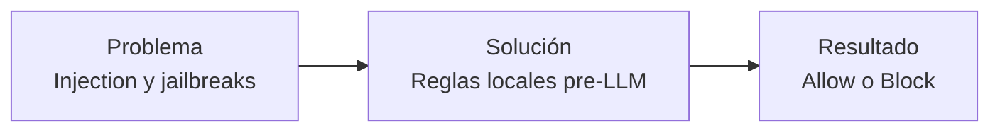

<div align="center">

# prompt-firewall

**Firewall local de prompts** · Angel Salazar

<br/>


</div>

---

### `$ cat diagrama.md`



---

### `$ cat problema.md`

Prompt injection y jailbreaks entran como texto “inocente”.  
Este repo bloquea patrones conocidos antes del LLM.

---

```bash
pip install -e .
pytest
python -m prompt_firewall batch
python -m prompt_firewall serve
```

UI: http://127.0.0.1:8011

---

Hecho en Lima · Angel Salazar · CIP 404730
