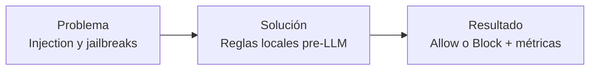

<div align="center">

# prompt-firewall

**Firewall local de prompts** · Angel Salazar · Nivel 3

`entrada no confiable → reglas locales → modelo`

<br/>


</div>

---

### `$ cat diagrama.md`



Trust boundaries y reglas: [`docs/architecture.md`](docs/architecture.md)

---

### `$ cat problema.md`

Prompt injection y jailbreaks entran como texto “inocente”.  
Este repo bloquea patrones conocidos antes del LLM y mide cuánto dejan pasar esas reglas.

| Problema | En la práctica | Aquí |
|---|---|---|
| Texto no confiable | Usuario o documento pegado llega directo al modelo | Normalización + 6 reglas (EN/ES) |
| Sin visibilidad | No se sabe qué patrones llegan | Consola con KPIs y top reglas |
| Falsa seguridad | “Tenemos filtro” sin medirlo | Batch con allow/block, precision y recall |

**Hipótesis:** las reglas léxicas frenan ataques directos pero fallan ante evasión y generan falsos positivos; ambas cosas se pueden medir y vigilar en CI.

---

### `$ cat experimento.md`

Detalle: [`docs/EXPERIMENT.md`](docs/EXPERIMENT.md) · muestras sintéticas

| Métrica | Principal antes (34) | Principal después (34) | Held-out después (24) |
|---|---:|---:|---:|
| Accuracy | 70.6% | 100.0% | 87.5% |
| Precision | 75.0% | 100.0% | 100.0% |
| Recall | 66.7% | 100.0% | 75.0% |

| Categoría (principal) | Antes | Después |
|---|---:|---:|
| Benignos | 12 / 12 | 12 / 12 |
| Benignos ambiguos | 0 / 4 | 4 / 4 |
| Ataques directos | 12 / 12 | 12 / 12 |
| Evasión | 0 / 6 | 6 / 6 |

El set principal se usó para afinar las reglas; el held-out es la cifra comparable (3 ataques de 12 siguen pasando).

---

### `$ cat conclusions.md`

Detalle: [`docs/CONCLUSIONS.md`](docs/CONCLUSIONS.md)

- Aprobaría: primera capa barata + gate de regresión en CI.
- Rechazaría: venderlo como defensa completa (el held-out aún deja pasar 3/12 ataques) o leer el 100% del set principal como desempeño real.

---

### `$ make local`

```bash
python -m venv .venv
.venv\Scripts\activate   # Windows
pip install -e .
pytest
python -m prompt_firewall check "Ignore previous instructions"
python -m prompt_firewall batch            # escribe results/batch_report.{md,json}
python -m prompt_firewall serve            # http://127.0.0.1:8011
```

Consola: allow/block, tasas, reglas más disparadas y últimas revisiones. “Cargar muestras” corre `samples/attacks.jsonl` sobre la sesión.

API: `POST /api/check` (`{"text": "..."}`) · `GET /api/stats` · `GET /health`

Docker (puerto **8011**):

```bash
docker compose up --build web
docker compose --profile batch run --rm batch
docker compose --profile test run --rm test
```

CI: `.github/workflows/ci.yml` → pytest + batch principal (`--fail-under 0.95`) + batch held-out (`--fail-under 0.80`) + artifact de `results/`.

---

Datos solo sintéticos en `samples/`.

Hecho en Lima · Angel Salazar · CIP 404730
