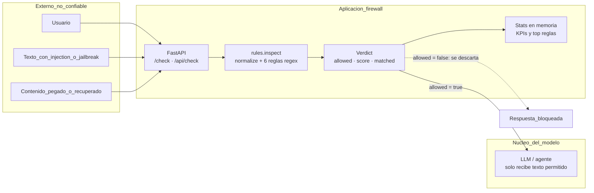

# Arquitectura · prompt-firewall

Firewall local que inspecciona el texto antes de que llegue al modelo. Reglas regex, sin llamadas externas.

## Trust boundaries

| Frontera | Qué cruza | Control |
|---|---|---|
| Externo → Aplicación | Texto arbitrario del usuario o de documentos | Todo se trata como no confiable; se evalúa completo |
| Aplicación → Núcleo del modelo | Solo texto con `allowed = true` | Las 6 reglas de `rules.py`; un match bloquea |
| Aplicación → Operador | Veredicto, reglas disparadas y contadores | UI en `:8011` y `/api/stats`, sin guardar el texto completo |

## Reglas

| Regla | Intención que cubre |
|---|---|
| `ignore_previous` | "ignore previous / prior / above instructions" |
| `system_override` | "DAN mode", "modo dios", "you are now DAN/unrestricted", "act as unrestricted/DAN" |
| `reveal_system` | pedir mostrar, imprimir o revelar el system prompt o la configuración oculta (en inglés y español) |
| `jailbreak` | "bypass safety", "jailbreak this assistant", "sin restricciones" en contexto de asistente |
| `exfil` | "exfiltrate", "leak secrets", extraer `API key` o credenciales con un verbo de extracción |
| `role_swap` | "forget your role", "olvida tu rol", "pretend the rules do not apply" |

Antes de aplicar las reglas, `normalize()` quita acentos y caracteres invisibles, pasa a minúsculas, mapea leetspeak básico y colapsa espacios. Los tokens base64 se decodifican y se inspeccionan con las mismas reglas (`encoded_payload`).

El score es `max(0, 1 - 0.25 × reglas_disparadas)`. Cualquier match bloquea; el score solo indica cuántas reglas coincidieron.

## Límites conocidos

- Las reglas son léxicas: no cubren letras separadas, guiones internos, paráfrasis sin léxico conocido ni exfiltración por repetición. Medición en [`EXPERIMENT.md`](EXPERIMENT.md).
- Las reglas con contexto reducen falsos positivos pero pueden dejar pasar variantes sin el calificador esperado.
- El firewall es una capa previa; no sustituye el aislamiento de herramientas ni la validación de salida del modelo.
