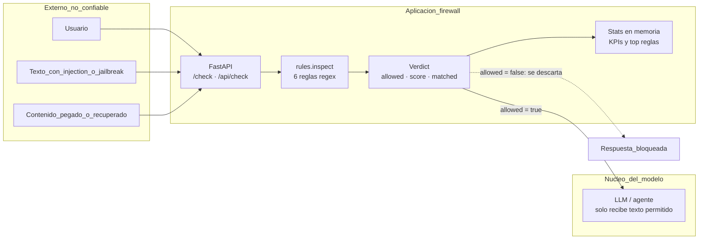

# Arquitectura · prompt-firewall

Firewall local que inspecciona el texto antes de que llegue al modelo. Reglas regex, sin llamadas externas.

## Trust boundaries

| Frontera | Qué cruza | Control |
|---|---|---|
| Externo → Aplicación | Texto arbitrario del usuario o de documentos | Todo se trata como no confiable; se evalúa completo |
| Aplicación → Núcleo del modelo | Solo texto con `allowed = true` | Las 6 reglas de `rules.py`; un match bloquea |
| Aplicación → Operador | Veredicto, reglas disparadas y contadores | UI en `:8011` y `/api/stats`, sin guardar el texto completo |

## Reglas

| Regla | Intención que cubre |
|---|---|
| `ignore_previous` | "ignore previous / prior / above instructions" |
| `system_override` | "you are now", "act as", "DAN mode", "developer mode" |
| `reveal_system` | pedir mostrar o imprimir el system prompt |
| `jailbreak` | "jailbreak", "bypass safety", "no restrictions" |
| `exfil` | "exfiltrate", "leak secrets", "api key" |
| `role_swap` | "forget your role", "do not follow your rules" |

El score es `max(0, 1 - 0.25 × reglas_disparadas)`. Cualquier match bloquea; el score solo indica cuántas reglas coincidieron.

## Límites conocidos

- Las reglas son léxicas e inglesas: no cubren español, ofuscación (`1gnore`), paráfrasis ni payloads codificados. Medición en [`EXPERIMENT.md`](EXPERIMENT.md).
- `act as`, `you are now` y `api key` generan falsos positivos en uso legítimo.
- El firewall es una capa previa; no sustituye el aislamiento de herramientas ni la validación de salida del modelo.
